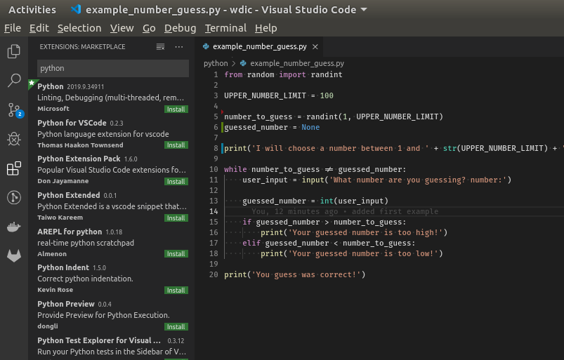

title: Installation
parent: uebersicht.md
next: beispiele.md

# Vorbereitungen fürs Tutorial
Für unsere Arbeit benötigen wir:
* **Python** (einfach eine möglichst aktuelle Version)
* **Visual Studio Code**
  * Extension für Python

Für das Tutorial ist es egal, unter welcher Plattform gearbeitet wird (Windows/Linux/MacOS/...). Um eine gemeinsame Basis für die Entwicklungsumgebung zu bieten, möchte ich euch **Visual Studio Code** (nicht zu verwechseln mit *Visual Studio*!) empfehlen.

# Installation Visual Studio Code
Hier geht's zum Download: [Visual Studio Code Download](https://code.visualstudio.com/download) . Wählt die für euch passende Plattform aus und führt die Installation durch.

# Installation Python
Wir benötigen eine Python Installation mit Version >= 3.10.

Es gibt viele Möglichkeiten Python zu installieren und manche Plattformen liefern Python direkt mit (MacOS/Linux).

Unter Windows erfolgt die Installation am einfachsten über den **Microsoft Store**. Dazu den Store öffnen, dort nach "Python" suchen und die gewünschte Version (z.B. *Python 3.12* von der Python Software Foundation) installieren. Die Installation läuft damit im Hintergrund, Updates werden ebenfalls über den Store abgewickelt.

Der große Vorteil dieser Variante: Der Pfad zu Python wird automatisch in der `PATH`-Umgebungsvariable eingetragen (mittels sogenannter App-Ausführungsaliase), sprich `python` lässt sich direkt im Terminal bzw. in Visual Studio Code aufrufen.

# Visual Studio Code Erweiterung für Python

Nach dem Start von Visual Studio Code gibt es auf der linken Seite eine Toolbar. Dort "Extensions" auswählen und nach "python" suchen und installieren.

# Test der Installation

1. Erstelle eine neue Datei (<kbd>Ctrl</kbd> + <kbd>n</kbd>)
2. Schreibe folgendes in diese Datei: `print('Hello world!')`
3. Speichere diese Datei (<kbd>Ctrl</kbd> + <kbd>s</kbd>) unter `test.py`
4. Führe diese Datei aus mittels <kbd>Ctrl</kbd> + <kbd>F5</kbd> (oder rechts oben auf den "Play" Button klicken)
5. Unten sollte im Terminal (neben anderen Meldungen) `Hello world!` erscheinen